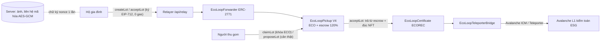

# EcoLoop · Doorstep recycling marketplace on Avalanche

**Test:** `npm test` → 119/119 pass (Hardhat EDR, không cần node riêng) · **Contract:** 5/5 verify trên Snowtrace · **ICM:** 5/5 chứng nhận đã tới Dispatch L1

> **EN:** EcoLoop connects households, informal waste collectors and EPR-obligated brands. A collector locks **120% ECO escrow** to claim a pickup, weighs the scrap at the door, the household accepts on-chain, and the contract pays from escrow and mints an **on-chain SVG recycling certificate (ECOREC NFT)**. Household actions are **gasless (ERC-2771)**, and certificates can be attested to another Avalanche L1 through **Avalanche ICM (Teleporter)**. Built for Team1 Vietnam UniHack 2026.

**Demo:** https://ecoloop-pi-six.vercel.app · **Pitch deck:** `EcoLoop-Avalanche-T1-PitchDeck.pdf` · **Tài liệu ICM:** [docs/AVALANCHE-ICM.md](docs/AVALANCHE-ICM.md)

## Dành cho giám khảo: kiểm tra trong 3 phút

1. Mở bảng contract bên dưới: mọi contract đã **verify mã nguồn trên Snowtrace**, đọc được hàm `claimLot`, `acceptLot`, `bridgeCertificate`.
2. Mở **[Bằng chứng on-chain](docs/ON-CHAIN-PROOF.md)**: mỗi luồng (ký quỹ, quỹ ứng trước miễn gas, P2P, cân lại, trả đơn, hủy, đổi quà, điểm danh) có link Snowtrace từng giao dịch. Đây là giao dịch kiểm thử từ ví test của nhóm, ghi rõ như vậy.
3. Mở demo, đăng nhập bằng Core (Fuji) hoặc tài khoản mật khẩu, xem lô đang mở trên bản đồ, chứng nhận ECOREC trong **Ví xanh** kèm trạng thái gửi qua **Avalanche ICM**.
4. Chạy test: `npm install && npm test`: 119 test trên EVM thật (Hardhat EDR), gồm 61 test đơn vị, fuzz bất biến ký quỹ/tổng cung, 19 test cầu ICM (giả mạo, phát lại, sai chain).

### Hợp đồng trên Fuji

<!-- contracts:start -->
Mạng: **Avalanche Fuji C-Chain (43113)** · block triển khai #61362576 · cập nhật 2026-11-20

| Contract | Địa chỉ (Snowtrace) | Deploy |
|---|---|---|
| EcoLoopPickup V4 (ECO + escrow + ERC-2771) | [`0x6C0309FD70255cC87d53B14c71F17Ba75b131b8f`](https://testnet.snowtrace.io/address/0x6C0309FD70255cC87d53B14c71F17Ba75b131b8f#code) | [tx](https://testnet.snowtrace.io/tx/0x5d52575ce9cf9ca5225204ddd9c9130fed4203bb4ced4762bb8de1931c5ef663) |
| EcoLoopCertificate (ECOREC NFT, SVG on-chain) | [`0x49487c0656713535c416097E988c447a86DD5a6B`](https://testnet.snowtrace.io/address/0x49487c0656713535c416097E988c447a86DD5a6B#code) |  |
| EcoLoopForwarder (gasless, ERC-2771) | [`0xfdA90d9becdF9F6019c9D042CadE9DC61AB2C2ED`](https://testnet.snowtrace.io/address/0xfdA90d9becdF9F6019c9D042CadE9DC61AB2C2ED#code) | [tx](https://testnet.snowtrace.io/tx/0x38a677a6755a56d5946d7b319d52b66c412bebecd3b9de3e0c060dd662fc743d) |
| EcoLoopRewards (check-in, missions) | [`0x6E46f3e458E123fc665D23Aa0D9dc18b6af10fBd`](https://testnet.snowtrace.io/address/0x6E46f3e458E123fc665D23Aa0D9dc18b6af10fBd#code) | [tx](https://testnet.snowtrace.io/tx/0x94bb8fa1f9920f93e46c739c1504d887f83ce9aabe6179a9269d5789ec5952fa) |
| EcoLoopTeleporterBridge (Avalanche ICM, source) | [`0x11812cf3eD0EFc07345308F194F7A60846B89083`](https://testnet.snowtrace.io/address/0x11812cf3eD0EFc07345308F194F7A60846B89083#code) | [tx](https://testnet.snowtrace.io/tx/0x750110db75f43d87cc676d44afb4e1b1e14bf4574ee3c1757ae2088a8f27c202) |

**ICM (Teleporter) thật:** Fuji C-Chain → Dispatch (Avalanche L1 testnet) (blockchainID `0x9f3be606497285d0ffbb5ac9ba24aa60346a9b1812479ed66cb329f394a4b1c7`), bridge đích [`0xdA71C1dCC8209006f2AfFDd7E406D0f31146Ac4C`](https://subnets-test.avax.network/dispatch/address/0xdA71C1dCC8209006f2AfFDd7E406D0f31146Ac4C).

| Chứng nhận | Gửi trên Fuji | messageID (Teleporter) | Ở L1 đích |
|---|---|---|---|
| ECOREC #1 | [tx](https://testnet.snowtrace.io/tx/0xa64f8810499bf8825ec9b105e3181e22f75b11cf98f94da7496013c94719a9df) | `0x3e0eeb2e5cac5045…` | **đã nhận** ✅ |
| ECOREC #2 | [tx](https://testnet.snowtrace.io/tx/0xbe41981e58af559d4084383407580e3182a6123537c61eaecf159ade254f8f69) | `0xcbcab02bc1abdf21…` | **đã nhận** ✅ |
| ECOREC #4 | [tx](https://testnet.snowtrace.io/tx/0x6f70466bbef69373db809ed426fa202eea75821eee67a81c6148d54b6cca0908) | `0x52ab197ab15cb4e1…` | **đã nhận** ✅ |
| ECOREC #5 | [tx](https://testnet.snowtrace.io/tx/0x4a7051ff39fe32b9f24650204f20d81d6e55a9a3f5e3f09748cf3c93d1bee7fd) | `0xc56aa2739fc01789…` | **đã nhận** ✅ |
| ECOREC #7 | [tx](https://testnet.snowtrace.io/tx/0x91c33ff0fb36d246868df9e33f205c8d34aa2cd6105b2e834792b2f4ad808d3b) | `0x43c9958bcb4c777f…` | **đã nhận** ✅ |

Tự kiểm tra trên L1 đích: gọi `totalInboundAttestations()` hoặc `getInboundAttestation(sourceBlockchainID, lotId)` trên bridge [`0xdA71C1dCC8209006f2AfFDd7E406D0f31146Ac4C`](https://subnets-test.avax.network/dispatch/address/0xdA71C1dCC8209006f2AfFDd7E406D0f31146Ac4C) (RPC `https://subnets.avax.network/dispatch/testnet/rpc`).
<!-- contracts:end -->

### Kiến trúc



### Chống gian lận (anti-Sybil)

- Ký quỹ ECO 120% nên người thu gom bỏ việc sẽ không được gì; hai ví thông đồng giao dịch P2P cũng không in thêm được ECO (chỉ trả từ khoản ký quỹ).
- Chỉ lô do **trạm thu gom xác minh** (ví có `COLLECTOR_ROLE`) hoàn tất mới được cộng vào `verifiedRecycledGrams`. Chỉ con số này mở khóa điểm danh và nhiệm vụ trong `EcoLoopRewards`.
- Mỗi chứng nhận ECOREC có thuộc tính `verified`. `EcoLoopTeleporterBridge` từ chối gửi chứng nhận chưa xác minh (`UnverifiedCertificate`), nên dữ liệu ESG gửi sang L1 khác chỉ gồm lô đã qua trạm.
- **Quỹ ứng trước ký quỹ:** trạm thu gom đã xác minh không cần có ECO hay AVAX. `claimLotSponsored` dùng `sponsorPool` (do nhãn hàng EPR hoặc quản trị viên nạp) để khóa khoản đảm bảo, tối đa 3 đơn cùng lúc; người bán vẫn được trả ECO theo số cân, phần dư quay về quỹ. Ví chưa xác minh không dùng được quỹ, nên hai ví thông đồng không rút được quỹ.
- **Không in thêm ECO ngoài 2 đường đã giới hạn:** admin phát hành tối đa `ADMIN_ISSUANCE_CAP` = 2.000.000 ECO (dự trữ quầy đổi + quỹ ứng trước), thưởng trạm tối đa 50% mỗi lô. Luồng `submit/approve` kế thừa từ V1 bị chặn trong V4 (`LegacyMintDisabled`, cờ `transient` trong `_update`), nên một trạm thông đồng với ví hộ dân không tự in được ECO.
- **Chống kéo dài tranh chấp:** hộ dân yêu cầu cân lại tối đa `MAX_DISPUTES` = 2 lần mỗi lần nhận đơn, sau đó chỉ còn chấp nhận hoặc để người thu gom trả đơn (hoàn 100% ký quỹ).
- Kiểm thử: `tests/pickup-contract.test.mjs` (anti-Sybil, chống lạm phát) và `tests/teleporter-bridge.test.mjs`.

### Đã làm / chưa làm (minh bạch)

- **Chạy thật trên Fuji:** đăng lô, ký quỹ ECO, cân, xác nhận, trả tiền từ escrow, NFT, đổi quà (burn ECO), relayer miễn gas.
- **Mô phỏng, chưa phải tiền thật:** khung thanh toán VNĐ (VietQR/ví/tiền mặt) chỉ để minh họa luồng tiền mặt ngoài đời; ước lượng kg từ ảnh dùng phân tích màu, không phải mô hình AI đã huấn luyện.
- **Tài khoản mật khẩu là ví demo:** khóa ví được tạo từ tên + mật khẩu (PBKDF2-SHA256, 600.000 vòng, mật khẩu ≥ 12 ký tự), nên chỉ dùng cho testnet. Ví thật dùng Google (thirdweb) hoặc Core.
- **Tin cậy ngoài chain:** cân và giao nhận vẫn do người thu gom thực hiện; contract chưa audit, chỉ dùng trên testnet.

---

## Giới thiệu (tiếng Việt)

Ứng dụng tái chế nhận ECO, đổi và giao quà. Giao diện tiếng Việt, dùng Core Wallet trên Chrome/Edge. Web mặc định chạy chế độ testnet với số liệu thật; demo là lựa chọn riêng.

## Chạy ứng dụng

Node.js 24 LTS, npm, Core extension trên Chrome hoặc Edge.

```powershell
cd D:\Hackathon
npm install
npm run dev
```

Mở **http://127.0.0.1:5173/** trực tiếp trong Chrome/Edge đã cài Core. `npm run dev` tự compile contract, chạy Vite và server ảnh. Không cần điền private key hoặc cấu hình contract trước khi kết nối ví.

Bản build để chạy ổn định:

```powershell
npm run build
npm start
```

Mở **http://127.0.0.1:4174/**. Server này phục vụ cả web và API ảnh. `npm run preview` chỉ phục vụ frontend tĩnh, không thay thế `npm start` khi dùng tính năng ảnh.

## Khởi tạo Fuji bằng Core — không nhập private key

1. Trong app chọn **Kết nối ví**, chọn Core, chấp nhận kết nối và chuyển mạng trong tiện ích ví. Ví kết nối được ngay cả khi chưa có contract.
2. Nạp **AVAX testnet** qua liên kết faucet trong app: https://core.app/tools/testnet-faucet/ . Faucet có thể áp dụng điều kiện riêng.
3. Bản hiện tại đã có contract Fuji dùng chung trong `config/app.json`. Người dùng chỉ kết nối ví; app kiểm tra runtime bytecode trước khi tải dữ liệu. Chrome và Edge tự đọc cùng contract, không cần nhập lại.
4. Có thể **Thêm ECO vào ví** và **Chia sẻ app** trong phần kết nối. Chọn vai trò **Người tái chế**, **Thu gom** hoặc **Quản trị** ở thanh bên; chỉ hiện vai trò ví được cấp.
5. Chỉ khi khởi tạo hệ thống mới: người vận hành bỏ địa chỉ chung trong cấu hình, chọn **Tôi là người tổ chức**, triển khai bằng Core rồi cập nhật địa chỉ mới vào `config/app.json` cho mọi người cùng dùng. Ví triển khai có quyền admin và collector. Không triển khai mới khi chuyển trình duyệt.

Bạn cần tự xác nhận các yêu cầu trong Core. App không giữ seed phrase hoặc private key. Nếu trình duyệt bên trong Codex báo chưa có ví, hãy copy URL sang Chrome/Edge đã cài Core. Không thể dùng extension của Chrome trong tab Codex không có extension đó.

**Lưu ý:** địa chỉ localhost chỉ truy cập được trên chính máy đang chạy app. Để nhiều người dùng máy/điện thoại khác nhau, host cùng Node app này trên máy chủ có HTTPS và ổ lưu trữ bền vững, rồi chia sẻ URL public đó. Các người dùng phải dùng cùng server ảnh và cùng contract.

## Luồng sử dụng thật

- **Ví A — người tái chế:** chọn Tái chế ngay, vật liệu, khối lượng dự kiến và ảnh JPG/PNG/WebP dưới 10 MB. Core yêu cầu ký xác thực lưu ảnh (không tốn gas), rồi ký giao dịch tạo yêu cầu. Chưa phát ECO ở bước gửi.
- **Ví B — điểm thu gom:** vào Điểm thu gom, kiểm tra yêu cầu, ký để xem ảnh, cân vật liệu thực tế rồi xác nhận. Contract phát ECO cho A. B không được duyệt yêu cầu do chính B gửi.
- **Ví A:** vào Đổi quà. Đổi phần thưởng bằng ECO; token bị đốt, tồn kho giảm, tạo biên nhận với chủ sở hữu là A.
- **Ví B:** kiểm tra người nhận đang kiểm soát đúng ví A và mã biên nhận, giao quà thực tế rồi xác nhận giao quà. Trạng thái được ghi trên chain; không thể giao cùng biên nhận lần hai.
- **Admin:** cấp/thu hồi COLLECTOR_ROLE cho các ví thu gom, thêm phần thưởng, sửa giá/tồn kho/trạng thái hoặc tạm dừng nghiệp vụ.

Đổi tài khoản trong Core sẽ tải lại đúng dữ liệu/quyền của tài khoản mới. Đổi sang sai mạng sẽ chặn thao tác và yêu cầu chuyển lại testnet. Kết nối trước đó được khôi phục bằng `eth_accounts` mà không tự bật hộp thoại ký. Lịch sử tải 100 bản ghi mỗi đợt; dùng Tải thêm lịch sử cũ hơn. App tự refresh khi đang mở sau mỗi 20 giây và khi giao dịch thành công.

Giao dịch chờ được lưu bằng hash trên trình duyệt, kể cả deploy. Nếu tải lại hoặc receipt timeout, mở kết nối và chọn Kiểm tra giao dịch trước khi gửi lại. App hỗ trợ theo dõi giao dịch được tăng phí/thay thế, và không coi giao dịch hủy là deploy thành công.

## Ảnh minh chứng và backend

Node server ở `server/` lưu ảnh tại `.data/<chainId>/<contract>/` cùng metadata người gửi. `.data` không đưa vào Git. Server cần giữ thư mục này khi deploy/restart và cần sao lưu dữ liệu.

- Tạo nonce dùng một lần, hết hạn sau 3 phút; người dùng ký thông điệp có action, chain, contract, wallet, SHA-256 và nonce.
- Upload chỉ nhận ảnh có magic bytes JPG/PNG/WebP, giới hạn 10 MB, kiểm tra hash trùng dữ liệu ký và kiểm tra runtime contract.
- Chủ ảnh được xem; ví khác phải có COLLECTOR_ROLE trên đúng contract. Mỗi lần truy cập cần chữ ký hợp lệ. URL ảnh không công khai; nonce/signature không đi qua query URL.
- Ảnh và metadata tách theo chain và contract. Quyền xem ảnh thay đổi theo quyền collector hiện tại.
- Có giới hạn request và dung lượng mặc định 1 GB. Tăng `MAX_STORAGE_MB` nếu cần; không có chức năng tự xóa ảnh.
- Gửi yêu cầu on-chain bị hủy sau upload có thể để lại ảnh chưa gắn với yêu cầu. Chủ ảnh vẫn có thể xem; gửi lại cùng ảnh bởi cùng ví không tạo bản sao file.

Khi host public: chạy Node sau HTTPS reverse proxy, đặt `APP_ORIGIN=https://ten-mien-cua-ban`, dùng một server/volume dữ liệu dùng chung. Không host frontend riêng mà thiếu route `/api`. `HOST` mặc định `127.0.0.1`; có thể đặt `HOST=0.0.0.0` trên host/container. `API_PORT` mặc định 4174. `.env.example` có các thiết lập.

### Vercel

- Dùng Node.js 24 và build command `npm run build`. Kiểm tra `/api/config` trả HTTP 200 sau khi deploy.
- Google: đặt `VITE_THIRDWEB_CLIENT_ID` cho môi trường Production bằng Client ID của dự án thirdweb đã dùng ở local. Thêm tên miền production vào Allowed Domains trên thirdweb rồi redeploy Vercel.
- Core: mở trực tiếp URL production trong Chrome đã cài và mở khóa Core. Cho phép extension truy cập tên miền đó, tải lại trang rồi chọn Core trong hộp thoại ví.
- Nullmaps trên Vercel: tải `vietnam.pmtiles` và `geocoder.db` từ `.tools/nullmaps-cloud/data/` lên một Vercel Blob store công khai. Đặt URL của hai tệp vào biến Production `NULLMAPS_PMTILES_URL` và `NULLMAPS_GEOCODER_DB_URL` rồi redeploy. Dùng tên tệp có phiên bản khi cập nhật dữ liệu. Kiểm tra `/api/maps/assets/style.json` và `/api/maps/geocode?q=Bến%20Thành`. Tùy chọn chạy qua máy chủ Nullmaps vẫn dùng `NULLMAPS_URL` và `NULLMAPS_API_KEY`.
- Config contract trên Vercel lấy từ `config/app.json` tại lúc deploy. Vercel dùng vùng lưu tạm để chạy API. Dùng Node với ổ đĩa bền vững để lưu ảnh, địa chỉ và thông tin bàn giao giữa các lần deploy.

## Smart contract

`contracts/EcoLoop.sol`: ERC-20 ECO + AccessControl + Pausable từ OpenZeppelin.

- `submit`: material 0 nhựa, 1 giấy, 2 kim loại, 3 thủy tinh; 1 g–1.000 kg; hash khác 0, chưa dùng.
- `approve`: collector, không tự duyệt; chỉ xử lý Pending một lần; dùng khối lượng thực nhận.
- `reject`: collector; Pending → Rejected, không thưởng.
- Rate cố định: nhựa 20, giấy 10, kim loại 40, thủy tinh 8 ECO/kg. ECO có 18 decimals.
- `redeem`: kiểm tra phần thưởng/tồn kho, burn ECO, ghi biên nhận.
- `fulfillRedemption`: collector đánh dấu giao đúng một lần, phát event RewardFulfilled.
- Admin cấp/thu hồi quyền, thêm/cấu hình quà, pause/unpause nghiệp vụ. Pause không khóa chuyển ERC-20.

ECO là token testnet có thể chuyển giữa các ví theo ERC-20; earned là tổng đã kiếm qua tái chế, khác số dư sau chuyển/đổi quà. App không cung cấp mua bán hoặc quy đổi tiền. Địa chỉ ví, vật liệu, khối lượng, hash và giao dịch trên chain là công khai. Ảnh chỉ lưu trên server ngoài chain.

Blockchain không tự xác minh rác ngoài đời. Collector là bên được tin cậy; cân/giao nhận vẫn do người tổ chức thực hiện. Chống trùng hash chỉ ngăn dùng lại đúng file, không ngăn sửa ảnh, Sybil hoặc thông đồng. Quà do người tổ chức tự cung cấp; không có tài trợ, cửa hàng hay voucher thương mại được tích hợp sẵn. Chưa audit để sử dụng với tài sản thật.

## Kiểm thử

```powershell
npm test
npm run build
node scripts/smoke-local.mjs
```

**119 test** chạy trên EVM thật (Hardhat EDR), không cần node riêng:

| File | Nội dung |
|---|---|
| `tests/pickup-units.test.mjs` | 61 test đơn vị cho EcoLoopPickup V4, mỗi test một hành vi, reset bằng `evm_snapshot`: ký quỹ, quỹ ứng trước, cân lại tối đa 2 lần, timeout, trần phát hành, chặn mint kiểu V1, ERC-2771, NFT, phần thưởng |
| `tests/pickup-invariants.test.mjs` | Fuzz có trạng thái: chuỗi hành động ngẫu nhiên (đúng và sai vai), sau **mỗi bước** kiểm tra 6 bất biến: `totalEscrowed` = tổng ký quỹ từng lô, contract luôn đủ ECO cho ký quỹ + quỹ, bảo toàn quỹ ứng trước, giới hạn 3 đơn tài trợ, tổng cung = ECO admin phát hành (thanh toán không in tiền), 1 NFT/lô hoàn tất. Chạy lâu hơn: `FUZZ_SEEDS=10 FUZZ_STEPS=200` |
| `tests/teleporter-bridge-units.test.mjs` | 19 test cho cầu ICM: cấu hình, gửi, nhận, giả mạo nguồn, sai chain, phát lại, payload hỏng, chuyển NFT, gửi tới 2 L1 |
| `tests/pickup-contract.test.mjs`, `tests/teleporter-bridge.test.mjs` | Kịch bản đầu-cuối |

Ngoài ra: quyền/khối lượng/phát thưởng/burn/tồn kho/pause/giao quà một lần của contract V1; demo; ảnh với chữ ký, nonce dùng một lần, hash, quyền và persistence; adapter EIP-1193/6963 mô phỏng Core chạy luồng kết nối → add/switch chain → deploy → submit → approve → redeem → fulfill → khôi phục receipt. Không đồng nghĩa đã ký bằng extension Core thật trên Fuji: bước này cần ví người dùng có AVAX testnet.

## Chạy blockchain local

Terminal 1: `npm run chain`. Terminal 2: `npm run deploy:local`, sau đó `npm run dev`. Script ghi `.env.local` với chain 31337, RPC local và địa chỉ contract. Core cần hai tài khoản local phù hợp để làm người tái chế và collector.

Muốn quay lại Fuji: cấu hình `.env.local` thành chain 43113/RPC Fuji và bỏ địa chỉ local, hoặc xóa file cấu hình local bạn đã tạo, rồi restart app. Cấu hình browser được lưu riêng cho từng chain. Smoke test tự khôi phục .env.local và đóng chain tạm; `deployments/31337.json` từ smoke test chỉ là bản ghi kiểm thử, không phải node đang hoạt động.

Nếu muốn deploy bằng CLI thay vì Core, vẫn có `npm run deploy:fuji` sử dụng `DEPLOYER_PRIVATE_KEY` từ .env (ví testnet riêng). Không gửi key vào chat, không dùng biến `VITE_` cho key và không commit file .env.

## Nguồn

- Fuji chain ID 43113, RPC https://api.avax-test.network/ext/bc/C/rpc
- Avalanche: https://build.avax.network/docs/dapps
- Core: https://core.app/
- EIP-6963: https://eips.ethereum.org/EIPS/eip-6963

React + TypeScript + Vite, viem, Solidity 0.8.37, Hardhat 3, OpenZeppelin 5, Node HTTP/filesystem backend. Giao diện và thương hiệu EcoLoop được xây mới, lấy cảm hứng từ mô hình tái chế nhận thưởng của Relotto.


## Giao diện ứng dụng

EcoLoop là app tái chế và nhận thưởng: tổng quan ví ECO, tạo yêu cầu theo loại vật liệu, theo dõi xác nhận, đổi quà, xác nhận giao quà và quản trị theo quyền ví. Giao diện tối lấy cảm hứng phong cách sản phẩm tham chiếu; không có canvas, node editor hoặc công cụ tạo workflow.

## Bản hoàn thiện MVP

- Contract chung được server cung cấp qua `/api/config` từ `config/app.json`. Chrome/Edge mới tự dùng cùng hệ thống; bytecode được kiểm tra khi tải tài khoản.
- Chọn không gian Người tái chế / Thu gom / Quản trị ở thanh bên. Chỉ hiện vai trò mà ví được cấp, demo cho phép thử mọi vai trò.
- Chi tiết REC hiển thị tiến trình, khối lượng dự kiến/thực tế, ECO, ảnh có kiểm soát truy cập và tra giao dịch gần đây.
- Trùng ảnh được kiểm tra bằng mô phỏng contract trước khi ký tải ảnh. Lỗi custom và lỗi ví được giải thích bằng tiếng Việt.
- Biên nhận ECO-xxxx là mã tham chiếu công khai. Khi giao quà phải đối chiếu đúng ví và đúng contract, không chỉ mã biên nhận.
- Hướng dẫn triển khai Node/Docker, lưu trữ bền vững và demo hai ví nằm trong [docs/DEPLOY.md](docs/DEPLOY.md).

## Cập nhật theo mentor: Thu gom tận nơi

Đã bổ sung lô nhiều vật liệu, bản đồ khu vực, xác nhận hai phía, thông tin bàn giao riêng tư và chuẩn bị Google/ví nhúng. Xem [hướng dẫn kích hoạt V2, dùng demo và cấu hình thirdweb](docs/MENTOR-UPGRADE.md). Contract cũ và ECO cũ được giữ nguyên; V2 cần ví quản trị triển khai và kích hoạt, Google cần Client ID.

## Thiết lập: ngôn ngữ, giao diện, đơn vị, thông báo

Trang **Thiết lập** (menu bên trái hoặc nút cuối thanh điều hướng điện thoại) có:

- **Ngôn ngữ**: Tiếng Việt / English / Theo hệ thống. Đổi là áp dụng ngay cho toàn app, kể cả thông báo lỗi từ ví, contract và server.
- **Giao diện**: Sáng / Tối / Theo hệ thống; cỡ chữ Nhỏ → Rất lớn; giảm hiệu ứng chuyển động.
- **Đơn vị & định dạng**: hiển thị khối lượng bằng kg hoặc lb (ô nhập và hợp đồng vẫn dùng kg); định dạng số `1.234,5` hoặc `1,234.5`.
- **Thông báo trình duyệt**: báo khi lô của bạn đổi trạng thái lúc đang ở tab khác, có nút gửi thử.
- **Tài khoản & mạng**, **Dữ liệu & bộ nhớ** (xóa dữ liệu lưu trên máy, đặt lại thiết lập), **Giới thiệu** (phiên bản, mã nguồn, báo lỗi).

**Giao diện điện thoại**: app tự chuyển giữa giao diện máy tính và điện thoại theo kích thước màn hình (dưới 768px, hoặc điện thoại xoay ngang), đổi ngay khi xoay máy hay kéo cửa sổ. Trên điện thoại có thanh tab dưới cùng với nút **Đăng lô** ở giữa, ô tìm kiếm + nút **Bộ lọc** thu gọn, thẻ sản phẩm 2 cột, chi tiết lô và tài khoản mở dạng bảng trượt từ dưới lên, lịch sử dạng thẻ. Có thể chọn cố định trong **Thiết lập → Giao diện → Bố cục** (Tự động / Máy tính / Điện thoại). CSS điện thoại nằm ở `src/mobile.css`, áp dụng khi `<html data-layout="mobile">`.

Thiết lập được lưu trong trình duyệt (`localStorage`, khóa `ecoloop-settings-v1`).

Cách thêm chữ mới cho giao diện:

1. Viết chữ tiếng Việt trong `tr('…')` (import từ `src/settings.ts`). Phần thay đổi dùng `{tên}`: `tr('Đã bán {n}', {n: 5})`.
2. Thêm bản tiếng Anh vào `src/i18n.en.ts`.
3. Chạy `npm run i18n:check` để xem còn chữ nào chưa dịch.

Nếu sửa màu trong `src/web.css` hoặc `src/pickup.css`, chạy `npm run theme:dark` để tạo lại `src/theme-dark.css`.

## Hợp đồng thu gom V4: Ký quỹ ECO thông minh, Quầy đổi AVAX ↔ ECO, Miễn phí gas & Avalanche ICM

**Ký quỹ ECO bảo vệ hai chiều & Chống lạm phát nguồn cung.**
- Khi nhận một lô (`claimLot`), người thu gom khóa **120% giá trị ước tính bằng token ECO** vào hợp đồng (`ESCROW_BUFFER_BPS = 12_000`) kèm tham số `maximumDeposit` chống trượt giá. Người thu gom có thể quy đổi AVAX sang ECO trực tiếp trên chain qua hàm `buyEco(minimumEco)` (doanh thu AVAX được hạch toán tách biệt qua `exchangeProceeds`).
- Người thu gom cân thực tế tại chỗ (`proposeLot`), chủ lô đối chiếu và xác nhận (`acceptLot`). Hợp đồng tự động giải ngân số ECO thực tế cho chủ lô và hoàn trả phần dư cho người thu gom.
- **Bảo toàn tổng cung (Zero-Inflation C2C):** Giao dịch ngang hàng C2C thanh toán 100% từ khoản ký quỹ đã khóa, không phát hành thêm ECO mới (ngăn chặn hoàn toàn tấn công thông đồng wash-trading giữa 2 ví để in token). Quỹ thưởng xanh bổ sung (`collectorBonusBps`) chỉ kích hoạt khi đơn được nghiệm thu bởi trạm thu gom chính thức có `COLLECTOR_ROLE`.
- Nếu người thu gom trả việc hoặc quá 7 ngày không hoàn tất (`TIMEOUT = 7 days`), `releaseLot` hoàn trả toàn bộ ECO ký quỹ ngay cả khi hệ thống đang tạm dừng (`paused`).

**Miễn phí gas qua chuẩn ERC-2771 (`EcoLoopForwarder`).**
- Các thao tác của người dùng (`createLot`, `claimLot`, `proposeLot`, `acceptLot`, `disputeLot`, `cancelLot`, `releaseLot`, `redeemReward`, `fulfillRewardRedemption`, `transfer`) hỗ trợ ký cấu trúc EIP-712 và gửi qua relayer `/api/relay`. Hợp đồng thu hồi đúng định danh người ký qua `_msgSender()`.
- Cách bật: đặt `RELAYER_PRIVATE_KEY` trong `.env` bằng **một ví Fuji riêng** có ít AVAX test (không dùng khóa của ví quản trị). Server tự giới hạn lượt gọi theo ngày (`RELAY_DAILY_LIMIT`) và theo ví/giờ (`RELAY_HOURLY_PER_WALLET`); API hỗ trợ phí gas tối thiểu (`/api/relay/stipend`, tối đa 0.005 AVAX/24h) bắt buộc chữ ký xác thực ví.

**Chứng nhận tái chế NFT (`ECOREC`) 100% On-chain & Cầu nối liên chuỗi Avalanche ICM (Teleporter).**
- Mỗi lô hoàn tất tự động đúc một NFT `EcoLoopCertificate` (`ECOREC`) cho chủ lô với ảnh vector SVG và thuộc tính khối lượng từng loại vật liệu lưu hoàn toàn trên chain (xem trực tiếp trên Snowtrace và trang **Ví xanh**).
- Hợp đồng [contracts/EcoLoopTeleporterBridge.sol](contracts/EcoLoopTeleporterBridge.sol) tích hợp chuẩn **Avalanche Interchain Messaging (Teleporter — `0x253b2784c75e510dD0fF1da844684a1aC0aa5fcf`)**, cho phép đồng bộ bằng chứng tái chế EPR từ Avalanche Fuji C-Chain sang các mạng **Avalanche L1** kiểm toán ESG doanh nghiệp với cơ chế chống giả mạo và chống phát lại. Xem chi tiết tại [docs/AVALANCHE-ICM.md](docs/AVALANCHE-ICM.md).

**Chỉ dữ liệu thật & Bảo mật quyền riêng tư.**
- Mọi lô hàng, số dư, lượt bán hoàn tất, biên nhận đổi quà và chứng nhận NFT đều đọc trực tiếp từ hợp đồng trên Avalanche Fuji (không cộng số liệu ảo hay link IPFS giả lập).
- Tọa độ công khai trên chain được làm tròn ~1 km; số điện thoại, địa chỉ nhà, ảnh gốc và tin nhắn chỉ mở khóa cho đúng chủ lô và người thu gom đang nhận đơn thông qua chữ ký nonce dùng một lần và mã hóa `AES-256-GCM`. Danh sách tài khoản đăng ký được ẩn khỏi API công khai và quyền Quản trị tự động đồng bộ với `DEFAULT_ADMIN_ROLE` trên Smart Contract.

**Triển khai V4**, chọn một trong hai cách:
- Qua giao diện: vào **Thiết lập** bằng ví quản trị → **Triển khai bằng ví quản trị** (2 giao dịch: forwarder, rồi contract thu gom) → **Kích hoạt dùng chung**. Lô, ký quỹ và ECO của contract cũ vẫn thuộc địa chỉ cũ.
- Qua dòng lệnh: chạy `npm run deploy:pickup:fuji` (cần `DEPLOYER_PRIVATE_KEY` trong `.env`). Script triển khai Forwarder, Pickup V4 (kèm quầy đổi AVAX→ECO), Rewards, ghi địa chỉ vào `config/app.json`, `deployments/43113-latest.json` và bảng contract ở đầu README.
- Sau đó: `npm run seed:fuji` (lô thử), `npm run deploy:bridge:fuji` (ICM), `npm run verify:fuji` (verify trên Snowtrace).
- Mọi ví có thể đăng lô hoặc nhận thu gom lô của ví khác. Người nhận việc phải ký quỹ **ECO** (mua ECO bằng AVAX test qua quầy đổi `buyEco` của contract).
- Nếu chạy trên **Vercel**: server không ghi được `config/app.json`, nên nút **Kích hoạt dùng chung** không dùng được. Hãy chạy `npm run deploy:pickup:fuji` trên máy, commit file `config/app.json` rồi deploy lại. Đặt `RELAYER_PRIVATE_KEY` trong mục **Environment Variables** của Vercel.

## Thẻ ví EcoLoop (EcoLoop Card)

Địa chỉ ví của người dùng hiện như một thẻ thanh toán: trong hộp **Tài khoản & ví** (thẻ gọn) và ở đầu trang **Ví xanh** (thẻ đầy đủ). Thẻ hiện địa chỉ chia nhóm 4 ký tự, tên chủ thẻ, mạng Avalanche Fuji, số dư AVAX và ECO. Đây là ví tự quản lý trên testnet, không phải thẻ ngân hàng và không liên kết với tổ chức thẻ nào.

- **Nhận**: mã QR theo chuẩn EIP-681 (`ethereum:<ví>@43113?value=…` cho AVAX, `ethereum:<ECO>@43113/transfer?address=…&uint256=…` cho ECO). Có thể đặt số tiền và nội dung để tạo yêu cầu thanh toán; ví Core cũng đọc được.
- **Chuyển**: nhập hoặc quét địa chỉ, chọn AVAX/ECO, xem màn hình xác nhận rồi mới ký. ECO chuyển miễn phí gas qua relayer (hàm `transfer` đã nằm trong danh sách cho phép). AVAX trả phí mạng từ ví người gửi.
- **Quét QR trả tiền**: dùng camera (BarcodeDetector, hoặc jsQR khi trình duyệt không hỗ trợ), chọn ảnh có mã QR, hoặc dán link. Mã của mạng khác hay token khác ECO bị từ chối. Không có khoản nào được gửi khi chưa bấm xác nhận.
- **Lịch sử**: `GET /api/history?address=` đọc sự kiện của contract V4 (ECO nhận/chuyển/thưởng/đổi quà, khóa và hoàn ký quỹ, tiền bán lô, khoản chờ rút) từ khối triển khai (`pickupDeployBlock` trong `config/app.json`). AVAX gửi từ thiết bị này được ghi lại cục bộ; AVAX nhận từ ví khác xem trên Snowtrace qua liên kết trong lịch sử.

Thư viện QR nằm sẵn trong `src/vendor/` (qrcode-generator, MIT; jsQR, Apache-2.0) kèm giấy phép.
