# Kiến trúc Đa chuỗi Avalanche Native: EcoLoop L1 & ICM (Teleporter)

## 1. Tại sao EcoLoop được thiết kế chuyên biệt cho Avalanche?

Các sàn thu gom phế liệu tái chế C2C ngoài đời thực gặp hai rào cản kỹ thuật đối lập nhau nếu chỉ chạy trên một chuỗi EVM đơn lẻ:

1. **Tầng Hộ gia đình & Thu gom tận nơi (High-frequency Consumer Layer):** Yêu cầu tốc độ xác nhận tức thì (< 1 giây) ngay tại cửa nhà khi cân phế liệu và **trải nghiệm không phí gas (Zero-Gas UX)** cho người dân phổ thông.
2. **Tầng Doanh nghiệp & Kiểm toán Tín chỉ EPR / ESG (Enterprise Settlement Layer):** Yêu cầu tính thanh khoản cao trên **Avalanche C-Chain** hoặc các **Avalanche L1 chuyên biệt cho kiểm toán ESG**, nơi doanh nghiệp sản xuất (FMCG, bao bì, đồ uống) đối chứng chứng nhận tái chế thực tế theo quy định Trách nhiệm Mở rộng của Nhà sản xuất (EPR).

Kiến trúc **Avalanche Multi-Chain + Interchain Messaging (ICM / Teleporter)** giải quyết trọn vẹn cả hai bài toán mà không cần cầu nối tập trung (centralized bridge):

```mermaid
flowchart LR
    subgraph CChain["Avalanche Fuji C-Chain (43113)"]
        P["EcoLoopPickup V4\n(ECO Escrow + ERC-2771)"]
        NFT["EcoLoopCertificate\n(On-chain SVG ECOREC)"]
        SB["EcoLoopTeleporterBridge\n(Source Bridge)"]
        TM1["TeleporterMessenger\n0x253b...5fcf"]
    end

    subgraph ESGL1["Partner ESG Audit Avalanche L1"]
        TM2["TeleporterMessenger\n0x253b...5fcf"]
        DB["EcoLoopTeleporterBridge\n(Destination Registry)"]
        CORP["Doanh nghiệp Kiểm toán EPR / ESG"]
    end

    P -- "acceptLot()" --> NFT
    NFT -- "ownerOf & certificate()" --> SB
    SB -- "sendCrossChainMessage()" --> TM1
    TM1 == "Avalanche Warp Messaging (ICM)" ==> TM2
    TM2 -- "receiveTeleporterMessage()" --> DB
    DB --> CORP
```

---

## 2. Hợp đồng Thông minh Đã Triển khai & Kiểm thử

- **Hợp đồng cầu nối ICM:** [contracts/EcoLoopTeleporterBridge.sol](../contracts/EcoLoopTeleporterBridge.sol)
- **Giao diện chuẩn Ava Labs Teleporter:**
  - [contracts/interfaces/ITeleporterMessenger.sol](../contracts/interfaces/ITeleporterMessenger.sol) (`0x253b2784c75e510dD0fF1da844684a1aC0aa5fcf`)
  - [contracts/interfaces/ITeleporterReceiver.sol](../contracts/interfaces/ITeleporterReceiver.sol)
- **Kiểm thử tự động toàn trình:** [tests/teleporter-bridge.test.mjs](../tests/teleporter-bridge.test.mjs)

### Cơ chế Bảo mật Liên chuỗi (Defense-in-Depth)

1. **Xác thực Quyền sở hữu Chứng chỉ (`ownerOf`):** Chỉ chủ sở hữu hợp pháp của NFT `ECOREC #lotId` (hoặc quản trị viên được ủy quyền) mới có quyền phát thông điệp chứng thực `bridgeCertificate` sang Avalanche L1 đích.
2. **Xác thực Teleporter Messenger & Remote Sender:** Hàm `receiveTeleporterMessage` kiểm tra nghiêm ngặt `msg.sender == address(teleporterMessenger)` và đối chiếu cặp `(sourceBlockchainID, originSenderAddress)` với bảng `trustedRemotes`.
3. **Chống Phát lại (Replay Protection):** Mỗi chứng nhận `lotId` chỉ được chứng thực tối đa một lần cho mỗi `destinationBlockchainID` ở cả đầu gửi (`outboundMessageIds`) và đầu nhận (`hasInboundAttestation`), đảm bảo không thể nhân đôi sản lượng tái chế ESG.

---

## 3. Triển khai thật: Fuji C-Chain → Avalanche L1

`npm run deploy:bridge:fuji` (script [scripts/deploy-bridge.mjs](../scripts/deploy-bridge.mjs)) làm toàn bộ luồng trên mạng thật:

1. Triển khai `EcoLoopTeleporterBridge` trên Fuji, trỏ tới `EcoLoopCertificate` của contract thu gom đang dùng.
2. Triển khai bridge **chỉ-nhận** trên L1 đích (`certificate = address(0)`, `bridgeCertificate` bị khóa ở chain này).
3. Đọc blockchainID của hai chain qua Warp precompile (`0x0200…0005`) và khai báo `setTrustedRemote` hai chiều.
4. Gửi chứng nhận của một lô đã hoàn tất bằng `bridgeCertificate`, rồi chờ `hasInboundAttestation` trên L1 đích chuyển thành `true`.
5. Ghi địa chỉ, tx hash, messageID và trạng thái nhận vào `deployments/icm-latest.json` và bảng contract trong README.

Cần: một L1 testnet có TeleporterMessenger (`0x253b…5fcf`) và một ICM relayer chạy giữa Fuji và L1 đó (Builder Console: https://build.avax.network/console). Phí relayer để 0 nên relayer phải chấp nhận message không phí.

Trạng thái hiện tại của bản nộp nằm trong bảng **Hợp đồng trên Fuji** ở đầu README (tự cập nhật sau mỗi lần chạy script).
